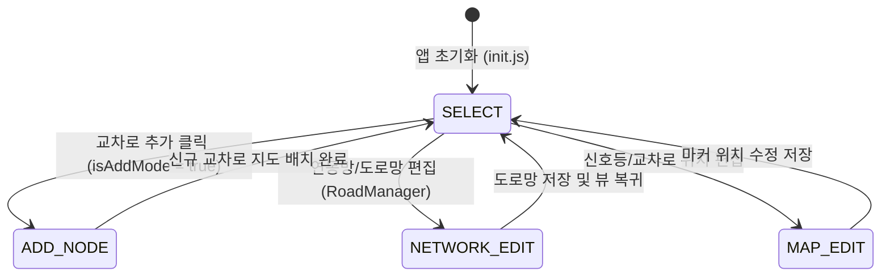
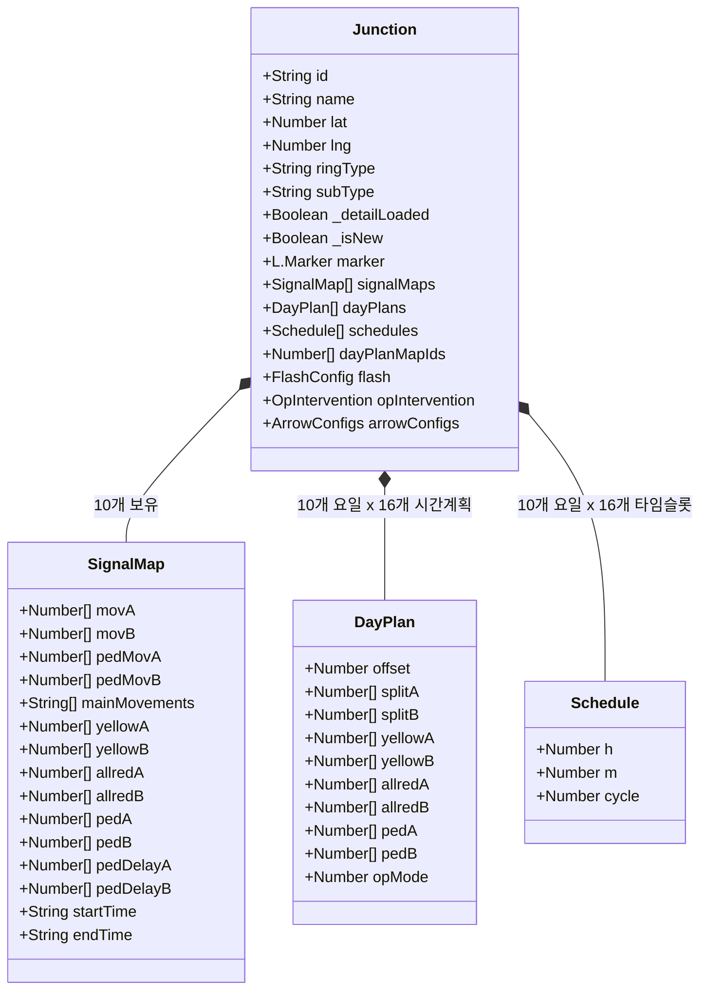
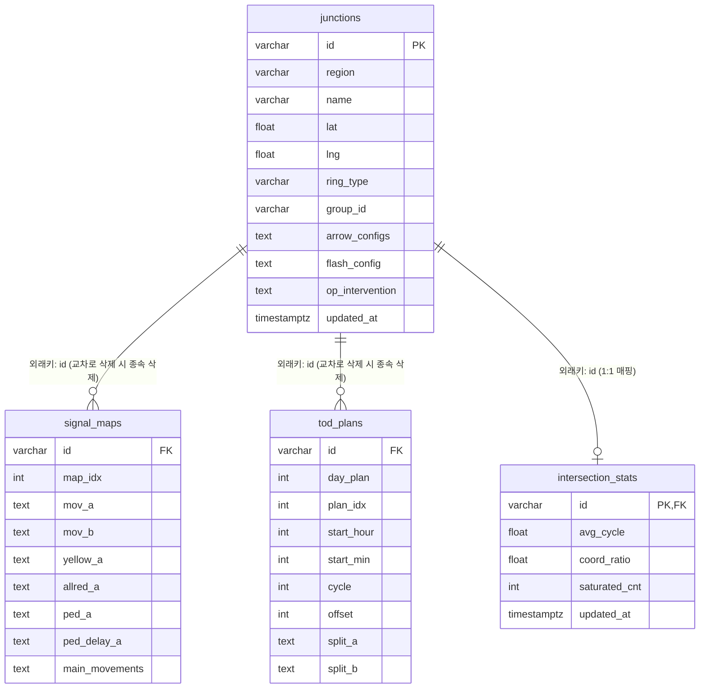
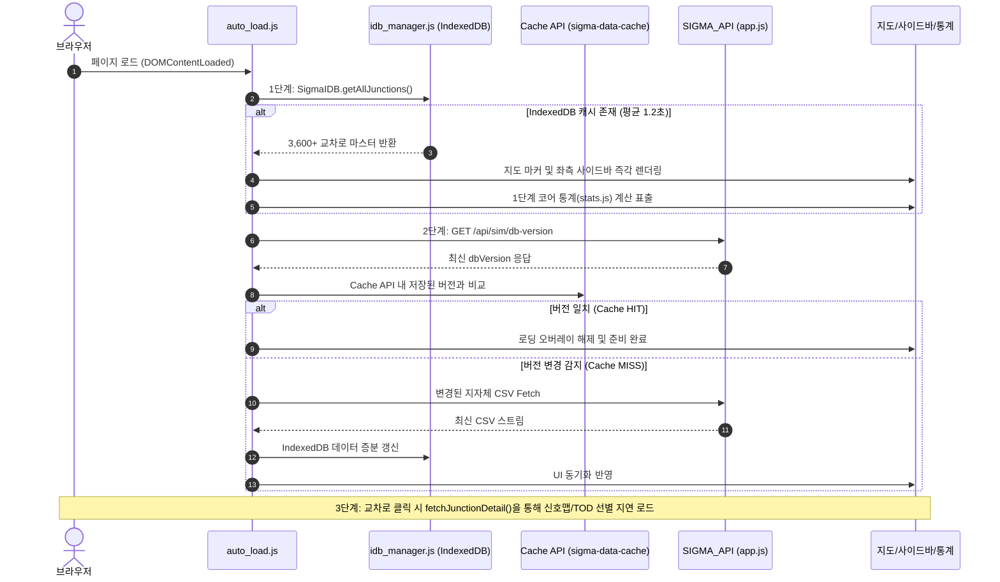
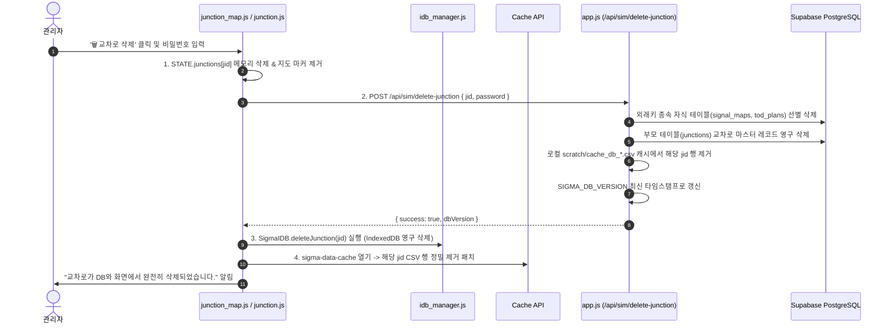

# SIGMA 시스템 마스터 아키텍처 및 상세 엔지니어링 명세서 (Master Blueprint)

> **문서 버전:** 2.0.0 (3단계 심층 고도화 반영판)  
> **최종 갱신일:** 2026-11-08  
> **대상 시스템:** SIGMA 웹 교통신호 시뮬레이터 & 관제 플랫폼  
> **용도:** 새로운 AI 대화 세션 및 유지보수 엔지니어가 시스템 전체 상태, 42개 프론트엔드 모듈, 데이터 스키마, 백엔드 API, 캐시 트랜잭션을 완전하게 파악하고 즉각 코드를 유지보수할 수 있도록 제작된 표준 기술 명세서입니다.

---

# [1차 고도화] 데이터 스키마 & 전역 상태 머신 심층 명세

## 1.1 Leaflet 기반 프론트엔드 전역 상태 (`window.STATE`)

[`config.js`](file:///c:/Users/since/OneDrive/바탕%20화면/SIGMA/SIGMA_SIM/js/config.js)에 선언된 `STATE`는 단일 진실 공급원(Single Source of Truth)으로 동작하며 모든 뷰 컴포넌트가 이를 구독 및 변경합니다.

### 전역 `STATE` 상세 속성 표

| 카테고리 | 속성명 | 타입 | 기본값 | 설명 및 비즈니스 로직 |
| :--- | :--- | :--- | :--- | :--- |
| **모드** | `appMode` | `string` | `'SELECT'` | `CONFIG.APP_MODE` (`SELECT`, `NETWORK_EDIT`, `MAP_EDIT`, `ADD_NODE`) |
| **교차로 마스터** | `junctions` | `Object<string, Junction>` | `{}` | 전체 교차로 맵. Key는 교차로 ID (`jid`, 예: `'L01-18210'`) |
| **활성 포커스** | `activeJid` | `string \| null` | `null` | 현재 지도/오버레이에서 활성화된 단일 교차로 ID |
| **다중 선택** | `selectedJids` | `Array<string>` | `[]` | 다중 선택되거나 그룹 단위 작업에 포함된 교차로 ID 배열 |
| **스케일** | `nodeScale` | `number` | `1.0` | 지도 위 교차로 노드 마커의 시각적 크기 배율 |
| **스케일** | `arrowScale` | `number` | `1.5` | 방향별 신호 화살표의 시각적 크기 배율 |
| **테마** | `currentTheme` | `string` | `'dark'` | UI 및 Leaflet 타일 테마 (`'dark'` \| `'light'`) |
| **연동 그룹** | `groups` | `Object` | `{}` | 연동 그룹 마스터 데이터 (그룹명, 소속 교차로 목록, 순서 등) |
| **시공도 인덱스** | `selectedTodPlanIdx` | `number` | `0` | 시공도(TSD) 분석 대상 TOD 시간계획 인덱스 (0~15) |
| **요일 플랜** | `currentGroupDayTypeIdx` | `number` | `0` | 0:평일, 1:금요일, 2:토요일, 3:일요일, 4:특수일 |
| **캐시 핸들** | `loadedFiles` | `Object` | `{}` | 6대 파일(`inter`, `maps`, `plans`, `groups`, `stats`, `links`) 로드 플래그 |
| **통계 상태** | `isOpStatsExpanded` | `boolean` | `false` | 통계 뷰 상세 테이블 아코디언 확장 여부 |

---

## 1.2 `Junction` 엔터티 내부 데이터 구조

교차로 단일 객체(`Junction`)는 기본 메타데이터와 신호맵 10종, 요일별 TOD 플랜 10종(각 16개 계획)을 내포하는 복합 데이터 트리입니다.

### `Junction` 주요 속성 명세
1. **식별 및 지리 정보**:
   - `id`: 교차로 표준 코드 (예: `'L01-18210'` - 서울 세종대로사거리)
   - `region`: 관할 지자체 코드 (`'L01'` ~ `'L30'`)
   - `name`: 교차로 공식 명칭
   - `lat`, `lng`: WGS84 좌표계 위경도
   - `seq`: 지자체 관리 연등 번호
   - `police`: 관할 경찰서 (예: `'종로경찰서'`)
   - `office`: 관할 행정구청 (예: `'종로구'`)
   - `group`: 소속 연동 그룹 코드
2. **신호 제어 구조**:
   - `ringType`: 링-배리어 구조 (`'Single'`, `'Dual'`, `'Dual-A'`, `'Dual-B'`)
   - `signalMaps[0..9]`: 1~10번 신호맵. 8개 현시(1~8)에 대한 `movA`(A링 이동류), `movB`(B링 이동류), 보행자 이동류(`pedMovA`, `pedMovB`), 황색(`yellowA/B`), 전적색(`allredA/B`), 보행시간(`pedA/B`) 및 보행지체(`pedDelayA/B`).
   - `dayPlans[0..9]`: 1~10번 일계획. 각 일계획은 16개 시간대별 스플릿(A/B링 각 8현시 초단위 할당) 및 옵셋(`offset`) 정보를 담음.
   - `schedules[0..9]`: 16개 타임슬롯의 시작 시각(`h`, `m`) 및 운영 주기(`cycle`).
   - `dayPlanMapIds[0..9]`: 일계획별 매핑된 신호맵 번호(0~9).
3. **런타임 제어 플래그**:
   - `_detailLoaded`: 서버 DB에서 신호맵/TOD 상세를 비동기로 가져왔는지 여부 (`true`일 때 재호출 차단).
   - `_isNew`: 화면에서 새로 생성되어 아직 RDB에 영구 저장되지 않은 임시 교차로 여부.

---

## 1.3 Supabase Cloud PostgreSQL 4대 핵심 테이블 스키마

백엔드([`app.js`](file:///c:/Users/since/OneDrive/바탕%20화면/SIGMA/SIGMA_API/sigma-backend/app.js))가 연동하는 RDB 관계형 스키마입니다.

---

# [2차 고도화] 42개 전 모듈 상세 명세 & 백엔드 엔드포인트 연동 맵

## 2.1 42개 프론트엔드 모듈 상세 명세 (`SIGMA_SIM/js/`)

### 클러스터 A: 코어 & 시스템 인프라 (8개)

1. [`config.js`](file:///c:/Users/since/OneDrive/바탕%20화면/SIGMA/SIGMA_SIM/js/config.js) (261줄)
   - **역할**: 전역 상수(`CONFIG`), 전역 상태(`STATE`), 메모리 캐시(`MEM_CACHE`), 빈 플랜/신호맵 팩토리 함수 제공.
   - **주요 함수**:
     - `createEmptySignalMap()`: 빈 신호맵 기본 객체 생성.
     - `createEmptyPlans()`: 16개 빈 TOD 플랜 배열 생성.
     - `createEmptySched()`: 16개 빈 스케줄 배열 생성.
     - `getSharedEmptyPlan()`: 캐시된 빈 플랜 Deep-Copy 반환.

2. [`init.js`](file:///c:/Users/since/OneDrive/바탕%20화면/SIGMA/SIGMA_SIM/js/init.js) (68줄)
   - **역할**: DOMContentLoaded 이벤트 수신 후 앱 부팅 오케스트레이션.
   - **주요 로직**: Leaflet 맵 초기화 확인, UI 이벤트 리스너 등록, `autoLoadFiles()` 트리거.

3. [`utils.js`](file:///c:/Users/since/OneDrive/바탕%20화면/SIGMA/SIGMA_SIM/js/utils.js) (930줄)
   - **역할**: 공통 UI 헬퍼 및 시간/데이터 연산 유틸리티.
   - **주요 함수**:
     - `showLoading(msg)` / `hideLoading()`: 전체 화면 로딩 오버레이 제어.
     - `isTimeInRange(time, start, end)`: 시분(HH:mm) 범위 판별.
     - `invalidateBrowserCache(keyword)`: 브라우저 Cache API에서 특정 URL 키워드 파기.

4. [`security.js`](file:///c:/Users/since/OneDrive/바탕%20화면/SIGMA/SIGMA_SIM/js/security.js) (34줄)
   - **역할**: 개인정보 마스킹 및 보안 유틸리티.
   - **주요 함수**: `maskSensitive(text)`: 식별 번호 및 관리자 토큰 마스킹.

5. [`auth.js`](file:///c:/Users/since/OneDrive/바탕%20화면/SIGMA/SIGMA_SIM/js/auth.js) (420줄)
   - **역할**: 관리자 인증 및 세션 보안 관리.
   - **주요 함수**:
     - `verifyAdminAuth(pwd)`: 관리자 비밀번호 검증 (SHA-256 해시 및 Base64 비교).
     - `resetSessionIdleTimer()`: 사용자 유휴 시간 30분 초과 시 세션 자동 잠금.

6. [`idb_manager.js`](file:///c:/Users/since/OneDrive/바탕%20화면/SIGMA/SIGMA_SIM/js/idb_manager.js) (146줄)
   - **역할**: 브라우저 IndexedDB(`SigmaIDB`) 기반 초고속 로컬 스토리지 엔진.
   - **주요 함수**:
     - `SigmaIDB.saveJunctions(junctionsMap)`: 교차로 마스터 벌크 저장.
     - `SigmaIDB.getAllJunctions()`: IDB 내 캐시된 교차로 전건 즉시 복원.
     - `SigmaIDB.deleteJunction(jid)`: 삭제된 교차로 IDB 트랜잭션 즉시 삭감.

7. [`auto_load.js`](file:///c:/Users/since/OneDrive/바탕%20화면/SIGMA/SIGMA_SIM/js/auto_load.js) (245줄)
   - **역할**: **3단계 점진적 데이터 자동 로더** 메인 엔진.
   - **주요 함수**:
     - `autoLoadFiles(forceRefresh)`: 1단계 IDB 로드 → 2단계 서버 DB 버전 확인(`db-version`) → 3단계 백그라운드 지연 스트리밍.

8. [`minigame.js`](file:///c:/Users/since/OneDrive/바탕%20화면/SIGMA/SIGMA_SIM/js/minigame.js) (612줄)
   - **역할**: 초기 대용량 데이터 로딩 대기 시 사용자 경험 증진을 위한 캔버스 미니게임 4종 (Fruit Catch, Flappy Bird, Snake, Brick Breaker).

---

### 클러스터 B: 데이터 입출력 & 파싱 (4개)

9. [`data.js`](file:///c:/Users/since/OneDrive/바탕%20화면/SIGMA/SIGMA_SIM/js/data.js) (1,108줄)
   - **역할**: 데이터 입출력 오케스트레이터, DB 관리 모달, 교차로 상세 동기화.
   - **주요 함수**:
     - `fetchJunctionDetail(jid)`: 특정 교차로 클릭 시 백엔드 `/api/sim/junction-detail/:id`로부터 신호맵/TOD 상세를 비동기 패칭하여 `STATE.junctions[jid]`에 주입.
     - `refreshDBStats()`: 현재 메모리에 적재된 교차로/신호맵 수치 통계 갱신.

10. [`data_parser.js`](file:///c:/Users/since/OneDrive/바탕%20화면/SIGMA/SIGMA_SIM/js/data_parser.js) (983줄)
    - **역할**: 교차로 CSV 파싱 및 직렬화.
    - **주요 함수**:
      - `processIntersectionCSV(csv, isAppend)`: 3,600+ 교차로 CSV 파싱 및 `STATE.junctions`에 객체 매핑 (헤더 인덱스 사전 캐싱 적용).
      - `serializeFlash(j)` / `serializeOpInt(j)` / `serializeArrows(j)`: 객체 상태를 단일 압축 텍스트로 직렬화.

11. [`worker_csv.js`](file:///c:/Users/since/OneDrive/바탕%20화면/SIGMA/SIGMA_SIM/js/worker_csv.js) (193줄)
    - **역할**: 메인 스레드 UI 블로킹을 방지하기 위한 대용량 CSV 파싱 전담 Web Worker.

12. [`db_report.js`](file:///c:/Users/since/OneDrive/바탕%20화면/SIGMA/SIGMA_SIM/js/db_report.js) (253줄)
    - **역할**: 교차로 팝업 내 'DB보기' 클릭 시 해당 교차로의 원천 RDB 테이블 로우를 서식화하여 모달로 출력 (`openDbReportOverlay`).

---

### 클러스터 C: 지도 & 공간 네트워크 시각화 (7개)

13. [`map.js`](file:///c:/Users/since/OneDrive/바탕%20화면/SIGMA/SIGMA_SIM/js/map.js) (173줄)
    - **역할**: Leaflet `map` 인스턴스 초기화, 줌/이동 이벤트, 다크/위성 레이어 토글 (`toggleMapTheme`).

14. [`junction_map.js`](file:///c:/Users/since/OneDrive/바탕%20화면/SIGMA/SIGMA_SIM/js/junction_map.js) (398줄)
    - **역할**: 교차로 서클 마커 드로잉(`drawJunction`) 및 팝업 UI 바인딩.
    - **상세**: 팝업 내 `상세보기`, `운영통계`, `DB보기`, `🗑️ 교차로 삭제` 원클릭 버튼 제공.

15. [`group_map.js`](file:///c:/Users/since/OneDrive/바탕%20화면/SIGMA/SIGMA_SIM/js/group_map.js) (65줄)
    - **역할**: 연동 그룹 선택 시 소속 교차로 간 연결선 및 하이라이트 레이어 렌더링 (`highlightGroupMembers`).

16. [`dashboard_map.js`](file:///c:/Users/since/OneDrive/바탕%20화면/SIGMA/SIGMA_SIM/js/dashboard_map.js) (170줄)
    - **역할**: 대시보드 모달 내 서울시 25개 자치구 GeoJSON 경계면 및 교차로 분포 히트맵 표출.

17. [`safetyzone.js`](file:///c:/Users/since/OneDrive/바탕%20화면/SIGMA/SIGMA_SIM/js/safetyzone.js) (218줄)
    - **역할**: 어린이/노인 보호구역 공간 데이터 레이어 비동기 로딩 및 지도 표출 (`toggleSafetyZone`).

18. [`rng_road_network.js`](file:///c:/Users/since/OneDrive/바탕%20화면/SIGMA/SIGMA_SIM/js/rng_road_network.js) (1,274줄)
    - **역할**: RNG(Relative Neighborhood Graph) 기반 노드-링크 도로망 생성 및 토폴로지 편집 에디터.

19. [`network_print.js`](file:///c:/Users/since/OneDrive/바탕%20화면/SIGMA/SIGMA_SIM/js/network_print.js) (1,744줄)
    - **역할**: 연동 네트워크 고해상도 PDF 도면 생성 및 그룹별 최적 밀집 확대도 자동 계산 및 출력.

---

### 클러스터 D: 교차로 & 신호 엔지니어링 (8개)

20. [`junction.js`](file:///c:/Users/since/OneDrive/바탕%20화면/SIGMA/SIGMA_SIM/js/junction.js) (821줄)
    - **역할**: **교차로 생명주기 관리**.
    - **주요 함수**:
      - `deleteJunction(targetJid)`: 교차로 영구 삭제 (임시 노드 즉시 제거, 정규 노드는 백엔드 `/api/sim/delete-junction` 호출 후 IDB/Cache API 증분 삭감).
      - `syncActiveJunctionData()`: 활성 교차로 UI 입력값을 `STATE`에 양방향 동기화.

21. [`intersection_search.js`](file:///c:/Users/since/OneDrive/바탕%20화면/SIGMA/SIGMA_SIM/js/intersection_search.js) (745줄)
    - **역할**: 좌측 사이드바 3,600+ 교차로 실시간 인덱싱 검색(초성 검색 지원), 가상 스크롤 렌더링.

22. [`junction_optimizer.js`](file:///c:/Users/since/OneDrive/바탕%20화면/SIGMA/SIGMA_SIM/js/junction_optimizer.js) (240줄)
    - **역할**: 교차로 이동류별 녹색 시간 배분 최적화 및 신호 모순 패턴 자동 진단.

23. [`phase.js`](file:///c:/Users/since/OneDrive/바탕%20화면/SIGMA/SIGMA_SIM/js/phase.js) (1,690줄)
    - **역할**: 링/배리어 현시 테이블 렌더링(`renderRingTables`), 신호맵 간 복사/붙여넣기, 현시 합계 및 황색/전적색 검증.

24. [`phase_diagram_interactive.js`](file:///c:/Users/since/OneDrive/바탕%20화면/SIGMA/SIGMA_SIM/js/phase_diagram_interactive.js) (870줄)
    - **역할**: HTML5 캔버스 기반 인터랙티브 신호 링-다이어그램 시각화 및 드래그 편집기.

25. [`sigmap_tab.js`](file:///c:/Users/since/OneDrive/바탕%20화면/SIGMA/SIGMA_SIM/js/sigmap_tab.js) (592줄)
    - **역할**: 1~10번 신호맵 그리드 뷰어 및 UTIC 표준 프로토콜 신호맵 가져오기.

26. [`table_logic.js`](file:///c:/Users/since/OneDrive/바탕%20화면/SIGMA/SIGMA_SIM/js/table_logic.js) (533줄)
    - **역할**: 현시 테이블 인풋 실시간 감지, 주기 일치성 유효성 검사 및 `STATE` 동기화.

27. [`table_popup.js`](file:///c:/Users/since/OneDrive/바탕%20화면/SIGMA/SIGMA_SIM/js/table_popup.js) (248줄)
    - **역할**: 대형 교차로 데이터를 모달 팝업 가상 스크롤로 조회하는 서브 테이블.

---

### 클러스터 E: 연동 제어 & TSD 시공도 (3개)

28. [`group.js`](file:///c:/Users/since/OneDrive/바탕%20화면/SIGMA/SIGMA_SIM/js/group.js) (1,435줄)
    - **역할**: 연동 그룹 편성, 간선도로별 교차로 순서 재배열, TOD 계획 옵셋/주기 일괄 편집.

29. [`group_parser.js`](file:///c:/Users/since/OneDrive/바탕%20화면/SIGMA/SIGMA_SIM/js/group_parser.js) (112줄)
    - **역할**: 연동 그룹 CSV 파싱 및 내보내기 직렬화.

30. [`tsd.js`](file:///c:/Users/since/OneDrive/바탕%20화면/SIGMA/SIGMA_SIM/js/tsd.js) (1,058줄)
    - **역할**: **시공도(Time-Space Diagram) 엔진**. Max Band Theory를 활용하여 양방향 최적 녹색 연동대역(Green Band) 계산 및 캔버스 드로잉.

---

### 클러스터 F: 통계 분석 & AI 진단 (4개)

31. [`stats.js`](file:///c:/Users/since/OneDrive/바탕%20화면/SIGMA/SIGMA_SIM/js/stats.js) (1,467줄)
    - **역할**: 거시/미시 교통 통계 산출 (네트워크 평균 주기, 연동률, 과포화 교차로, 비보호 좌회전, 보행지체 LOS).

32. [`insight_modal.js`](file:///c:/Users/since/OneDrive/바탕%20화면/SIGMA/SIGMA_SIM/js/insight_modal.js) (221줄)
    - **역할**: 통계 대시보드 내 특정 지표 클릭 시 원인 교차로 목록 및 분석 내역을 팝업으로 표출.

33. [`ai_report.js`](file:///c:/Users/since/OneDrive/바탕%20화면/SIGMA/SIGMA_SIM/js/ai_report.js) (282줄)
    - **역할**: LLM 기반 AI 비교분석 리포트 생성(`generateAIReport`) 및 인쇄용 HTML 변환.

34. [`chatbot_advanced.js`](file:///c:/Users/since/OneDrive/바탕%20화면/SIGMA/SIGMA_SIM/js/chatbot_advanced.js) (387줄)
    - **역할**: 우측 하단 AI 교통 전문가 챗봇 UI 및 백엔드 스트리밍 통신 인터페이스.

---

### 클러스터 G: UI & 사용자 경험 컴포넌트 (8개)

35. [`ui.js`](file:///c:/Users/since/OneDrive/바탕%20화면/SIGMA/SIGMA_SIM/js/ui.js) (1,286줄)
    - **역할**: 메인 탭 전환(`openTab`), 사이드바 토글, 단축키 처리, UI 레이아웃 관리.

36. [`ui_components.js`](file:///c:/Users/since/OneDrive/바탕%20화면/SIGMA/SIGMA_SIM/js/ui_components.js) (421줄)
    - **역할**: 감응 신호, 안전시설 등 폼 인풋 렌더러.

37. [`overlay_ui.js`](file:///c:/Users/since/OneDrive/바탕%20화면/SIGMA/SIGMA_SIM/js/overlay_ui.js) (772줄)
    - **역할**: 교차로 상세 정보 오버레이 탭 제어(`openDetailOverlay`).

38. [`home.js`](file:///c:/Users/since/OneDrive/바탕%20화면/SIGMA/SIGMA_SIM/js/home.js) (98줄)
    - **역할**: 홈 포털 대시보드 요약 뷰 및 미니 차트 렌더러.

39. [`dashboard.js`](file:///c:/Users/since/OneDrive/바탕%20화면/SIGMA/SIGMA_SIM/js/dashboard.js) (531줄)
    - **역할**: 종합 운영 대시보드 모달 및 지표 현황 관리.

40. [`simulation.js`](file:///c:/Users/since/OneDrive/바탕%20화면/SIGMA/SIGMA_SIM/js/simulation.js) (1,075줄)
    - **역할**: 실시간 신호 현시 가상 애니메이션 재생 및 시간별 신호 흐름 시뮬레이션.

41. [`civil.js`](file:///c:/Users/since/OneDrive/바탕%20화면/SIGMA/SIGMA_SIM/js/civil.js) (835줄)
    - **역할**: 교통 민원 접수 통계 엑셀 분석 및 시각화.

42. [`api_layers.js`](file:///c:/Users/since/OneDrive/바탕%20화면/SIGMA/SIGMA_SIM/js/api_layers.js) (118줄)
    - **역할**: 외부 오픈 API(UTIC, TOPIS) 레이어 인터페이스.

---

## 2.2 백엔드 핵심 REST API 엔드포인트 연동 맵 ([`app.js`](file:///c:/Users/since/OneDrive/바탕%20화면/SIGMA/SIGMA_API/sigma-backend/app.js))

| 엔드포인트 | Method | 역할 및 캐시 정책 | Payload / Query 파라미터 | Response 명세 |
| :--- | :---: | :--- | :--- | :--- |
| `/api/sim/db-version` | `GET` | 클라이언트 Cache-Busting용 최신 DB 타임스탬프 반환 | 없음 | `{ success: true, dbVersion: "1794140000000_v5" }` |
| `/api/sim/regions` | `GET` | 24개 관할 지자체 목록 반환 (`Cache-Control: 60s`) | 없음 | `{ success: true, regions: { 'L01': '서울시', ... } }` |
| `/api/sim/data` | `GET` | 지자체별 CSV 동적 생성 및 서버 로컬 캐시 서빙 | `?file=db_L01_intersections.csv` | CSV 텍스트 스트림 (`text/csv; charset=utf-8`) |
| `/api/sim/junction-detail/:id` | `GET` | 단일 교차로의 신호맵 및 TOD 상세 비동기 쿼리 | Path: `:id` (예: `L01-18210`) | `{ success: true, signal_maps: [...], tod_plans: [...] }` |
| `/api/sim/update-junction` | `POST` | 단일 교차로 신호/TOD RDB 트랜잭션 업데이트 | `{ jid, interCsvLine, mapCsvLines, todCsvLines, password }` | `{ success: true, message: "..." }` |
| `/api/sim/delete-junction` | `POST` | **교차로 영구 삭제** (외래키 종속 테이블 선별 삭제 + 로컬 CSV 캐시 갱신) | `{ jid, password }` | `{ success: true, dbVersion: "...", message: "..." }` |
| `/api/sim/batch-update-junctions`| `POST` | 대량 교차로 벌크 업데이트 큐잉 | `{ chunks: [{ jid, interCsvLine, ... }] }` | `{ success: true, count: N }` |
| `/api/ai/report` | `POST` | Groq / Gemini 모델 연동 AI 진단 리포트 생성 | `{ statsData, regionName }` | `{ success: true, report: "Markdown text..." }` |
| `/api/ai/chat` | `POST` | AI 전문가 실시간 대화형 챗봇 스트리밍 | `{ message, history }` | `{ success: true, reply: "..." }` |

---

# [3차 고도화] 핵심 시나리오 시퀀스 & 런타임 표준 운영 절차 (SOP)

## 3.1 [시나리오 A] 초고속 3단계 점진적 부팅 시퀀스 (Fast-First Booting)

---

## 3.2 [시나리오 B] 교차로 영구 삭제 트랜잭션 및 4중 캐시 무효화

데이터 삭제 시 브라우저를 새로고침해도 삭제된 교차로가 부활하지 않도록 4개 계층에서 정밀하게 삭제를 수행합니다.

---

## 3.3 [시나리오 C] 연동 시공도(TSD) Max Band 대역폭 계산 시퀀스

1. **대상 선정**: 사용자가 특정 연동 그룹(예: `G-01`)과 분석 시간대(예: 오전 첨두 08:00)를 선택.
2. **파라미터 추출**:
   - 각 교차로 간 물리적 거리(누적 거리 $D_i$).
   - 설계 속도(기본 $V = 50\text{ km/h}$).
   - 공통 주기($C$) 및 각 교차로의 옵셋($Offset_i$)과 주방향 녹색 스플릿($Split_i$).
3. **Max Band 밴드 탐색 알고리즘 ([`tsd.js`](file:///c:/Users/since/OneDrive/바탕%20화면/SIGMA/SIGMA_SIM/js/tsd.js))**:
   - 상향(Inbound) 및 하향(Outbound) 진행파에 대해 간섭(Interference)이 없는 최대 통과 띠 폭(Bandwidth, 초단위) 산출.
   - 캔버스 변환 수식:
     $$X(t) = \frac{t \pmod C}{C} \times \text{CanvasWidth}$$
     $$Y(D) = \frac{D - D_{\min}}{D_{\max} - D_{\min}} \times \text{CanvasHeight}$$
4. **결과 시각화**: 녹색 밴드 다각형(Polygon)을 캔버스 위에 반투명으로 중첩 렌더링.

---

## 3.4 향후 AI 세션 및 개발자를 위한 표준 운영 절차 (SOP)

> [!IMPORTANT]
> **새로운 대화 세션 시작 시 필수 확인 사항:**
> 1. 본 문서([`SIGMA_ARCHITECTURE.md`](file:///c:/Users/since/OneDrive/바탕%20화면/SIGMA/SIGMA_ARCHITECTURE.md))를 최우선 정독하여 파일 간 역할 분담을 확인하십시오.
> 2. 절대로 대형 파일([`data.js`](file:///c:/Users/since/OneDrive/바탕%20화면/SIGMA/SIGMA_SIM/js/data.js), [`stats.js`](file:///c:/Users/since/OneDrive/바탕%20화면/SIGMA/SIGMA_SIM/js/stats.js))에 무분별하게 신규 기능을 누적하지 마십시오. 새로운 기능은 독립 모듈로 생성하고 [`index.html`](file:///c:/Users/since/OneDrive/바탕%20화면/SIGMA/SIGMA_SIM/index.html)에 등록하십시오.
> 3. 일회성 테스트 스크립트 작성 시 반드시 `archive/patch_history/` 경로에 작성하여 루트 디렉토리가 오염되지 않도록 관리하십시오.
> 4. 프론트엔드 코드 수정 후에는 항상 `node --check <file>`을 통해 문법 검증을 선행하십시오.
