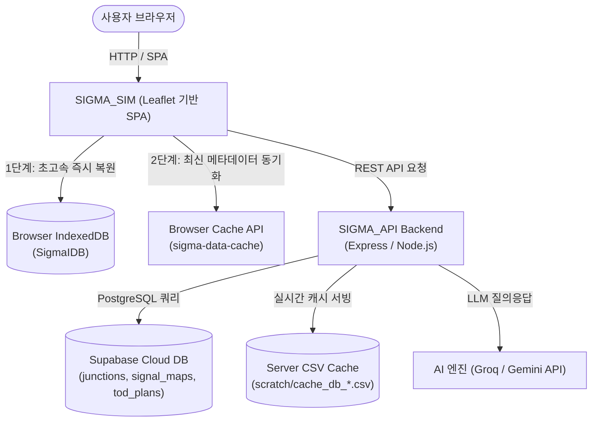

# SIGMA 시스템 전체 구조도 및 모듈 아키텍처 명세서 (Architecture Map)

> **문서 버전:** 1.0.0  
> **최종 갱신일:** 2026-11-08  
> **용도:** SIGMA 프로젝트의 전체 디렉토리, 42개 프론트엔드 자바스크립트 모듈, 백엔드 API, 데이터 파이프라인의 역할을 총정리한 마스터 아키텍처 문서입니다.  
> **※ 신규 대화 세션 및 유지보수 시 본 문서를 최우선 참조하여 시스템 상태를 파악하십시오.**

---

## 1. 시스템 하이레벨 토폴로지 (High-Level Topology)



---

## 2. 전역 상태 관리 (`STATE` 객체 in `SIGMA_SIM`)

`SIGMA_SIM`은 단일 전역 상태 객체 `window.STATE`를 중심으로 모든 뷰와 모듈이 반응형으로 연동됩니다.

| 프로퍼티 | 타입 | 설명 |
| :--- | :--- | :--- |
| `STATE.junctions` | `Object<string, Junction>` | 전체 교차로 데이터 마스터 맵 (Key: `jid`, 예: `'L01-18210'`) |
| `STATE.activeJid` | `string \| null` | 현재 화면에서 활성화/선택된 단일 교차로 ID |
| `STATE.selectedJids` | `Array<string>` | 다중 선택 또는 연동 그룹에 속한 교차로 ID 목록 |
| `STATE.groups` | `Object` | 연동 그룹 편성 정보 및 TSD(시공도) 순서 |
| `STATE.appMode` | `number` | 앱 동작 모드 (`SELECT: 0`, `ADD_JUNCTION: 1`, `ROAD_EDIT: 2` 등) |
| `STATE.sortedJunctions`| `Array<Junction>` | 사이드바 검색/필터링용 캐시된 정렬 배열 |

---

## 3. 디렉토리 구조 (Directory Layout)

```
c:\Users\since\OneDrive\바탕 화면\SIGMA\
├── SIGMA_ARCHITECTURE.md        # [본 문서] 시스템 전체 구조도 및 모듈 참조 명세서
├── README.md                    # 프로젝트 기본 안내서
├── .gitignore                   # 형상관리 제외 설정 (archive, scratch, node_modules 등)
│
├── SIGMA_SIM/                   # [프론트엔드] 교통신호 시뮬레이터 SPA
│   ├── index.html               # 메인 시뮬레이터 단일 진입점
│   ├── dashboard.html           # 단독 종합 운영 대시보드
│   ├── security_dashboard.html  # 보안 및 접속 로그 관제 대시보드
│   ├── help.html                # 사용자 매뉴얼
│   ├── tsd_popup.html           # 독립 TSD(시공도) 팝업 창
│   ├── css/                     # 스타일시트 (7개 파일)
│   │   ├── layout.css           # 전체 레이아웃 (헤더, 사이드바, 메인 지도)
│   │   ├── modals.css           # 팝업 모달, 오버레이 공통 스타일
│   │   ├── panels.css           # 우측 컨트롤 패널 및 아코디언 스타일
│   │   ├── tables.css           # 현시/스플릿 테이블, TOD 매트릭스 스타일
│   │   ├── theme.css            # 다크/라이트 테마 및 컬러 팔레트
│   │   ├── premium.css          # 네온 발광 효과 및 고급 UI 그래픽
│   │   └── style.css            # 기본 베이스라인 및 리셋 CSS
│   └── js/                      # 자바스크립트 엔진 (42개 모듈)
│
├── SIGMA_API/                   # [백엔드] REST API 서버 & 서브 시스템
│   └── sigma-backend/
│       ├── app.js               # Express 서버 진입점 (모든 API 라우트, DB 캐싱, 삭제, AI)
│       ├── db.js                # Supabase PostgreSQL 클라이언트 인스턴스 초기화
│       └── package.json         # 백엔드 의존성 설정
│
└── archive/                     # [보관소] 과거 패치 이력 및 일회성 스크립트 격리 보관소
    └── patch_history/           # 250+ 개 레거시 스크립트 격리 (Git 추적 제외)
```

---

## 4. `SIGMA_SIM/js/` 42개 전 모듈 상세 기능 분류

42개의 자바스크립트 모듈은 기능적 역할에 따라 **7개의 클러스터**로 구분됩니다.

### 클러스터 1: 코어 & 시스템 인프라 (Core & Infrastructure)

| 파일명 | 줄 수 / 크기 | 핵심 역할 및 주요 함수 | 연관 모듈 |
| :--- | :--- | :--- | :--- |
| [config.js](file:///c:/Users/since/OneDrive/바탕%20화면/SIGMA/SIGMA_SIM/js/config.js) | 261줄 (8.7KB) | 시스템 상수, 앱 모드 ENUM, 신호 링/현시 기본 템플릿 생성 (`createEmptySignalMap`, `createEmptyPlans`) | 전 모듈 |
| [init.js](file:///c:/Users/since/OneDrive/바탕%20화면/SIGMA/SIGMA_SIM/js/init.js) | 68줄 (2.5KB) | 어플리케이션 부팅, 라이브러리 로드 확인 및 DOM 이벤트 바인딩 진입점 | `index.html` |
| [utils.js](file:///c:/Users/since/OneDrive/바탕%20화면/SIGMA/SIGMA_SIM/js/utils.js) | 930줄 (34.9KB) | 로딩 오버레이 제어(`showLoading`, `hideLoading`), 시간 범위 검증, 브라우저 캐시 무효화 | 전 모듈 |
| [security.js](file:///c:/Users/since/OneDrive/바탕%20화면/SIGMA/SIGMA_SIM/js/security.js) | 34줄 (1.5KB) | 개인정보/민감정보 마스킹(`maskSensitive`), XSS 방어 유틸리티 | `auth.js` |
| [auth.js](file:///c:/Users/since/OneDrive/바탕%20화면/SIGMA/SIGMA_SIM/js/auth.js) | 420줄 (17.2KB) | 관리자 인증/권한 검증(`verifyAdminAuth`), 암호 해싱, 세션 유휴 타임아웃 관리 | `junction.js` |
| [idb_manager.js](file:///c:/Users/since/OneDrive/바탕%20화면/SIGMA/SIGMA_SIM/js/idb_manager.js) | 146줄 (4.8KB) | 클라이언트 IndexedDB(`SigmaIDB`) 입출력, 교차로 데이터 로컬 캐싱 및 즉각 복원 | `auto_load.js`, `junction.js` |
| [auto_load.js](file:///c:/Users/since/OneDrive/바탕%20화면/SIGMA/SIGMA_SIM/js/auto_load.js) | 245줄 (48.2KB) | **3단계 점진적 데이터 자동 로더** (`autoLoadFiles`): 1단계 IDB 로드 → 2단계 RDB 동기화 → 3단계 백그라운드 스트리밍 | `data.js`, `stats.js` |
| [minigame.js](file:///c:/Users/since/OneDrive/바탕%20화면/SIGMA/SIGMA_SIM/js/minigame.js) | 612줄 (24.9KB) | 대용량 데이터 로딩 대기 시간 동안 실행 가능한 캔버스 미니게임 4종 세트 | `auto_load.js` |

---

### 클러스터 2: 데이터 입출력 & 파싱 (Data Engine & I/O)

| 파일명 | 줄 수 / 크기 | 핵심 역할 및 주요 함수 | 연관 모듈 |
| :--- | :--- | :--- | :--- |
| [data.js](file:///c:/Users/since/OneDrive/바탕%20화면/SIGMA/SIGMA_SIM/js/data.js) | 1,108줄 (48.0KB) | **데이터 엔진 메인**: DB 현황판 갱신(`refreshDBStats`), 단일 교차로 상세 동기화(`fetchJunctionDetail`), DB 파일 입출력 핸들러 | `junction.js`, `phase.js` |
| [data_parser.js](file:///c:/Users/since/OneDrive/바탕%20화면/SIGMA/SIGMA_SIM/js/data_parser.js) | 983줄 (48.9KB) | 표준 교차로 CSV 파싱(`processIntersectionCSV`), 플래시/개입제어/신호화살표 직렬화 | `data.js` |
| [worker_csv.js](file:///c:/Users/since/OneDrive/바탕%20화면/SIGMA/SIGMA_SIM/js/worker_csv.js) | 193줄 (7.1KB) | 대용량 신호맵/TOD CSV 비동기 파싱을 위한 백그라운드 Web Worker 스크립트 | `data.js` |
| [db_report.js](file:///c:/Users/since/OneDrive/바탕%20화면/SIGMA/SIGMA_SIM/js/db_report.js) | 253줄 (14.1KB) | 특정 교차로의 DB 원천 로우 데이터를 테이블로 시각화하는 오버레이 (`openDbReportOverlay`) | `junction_map.js` |

---

### 클러스터 3: 지도 & 공간 네트워크 시각화 (Map & GIS Engine)

| 파일명 | 줄 수 / 크기 | 핵심 역할 및 주요 함수 | 연관 모듈 |
| :--- | :--- | :--- | :--- |
| [map.js](file:///c:/Users/since/OneDrive/바탕%20화면/SIGMA/SIGMA_SIM/js/map.js) | 173줄 (6.1KB) | Leaflet 지도 초기화, 다크/위성 지도 테마 토글(`toggleMapTheme`), 지도 이벤트 핸들러 | `junction_map.js` |
| [junction_map.js](file:///c:/Users/since/OneDrive/바탕%20화면/SIGMA/SIGMA_SIM/js/junction_map.js) | 398줄 (18.6KB) | 교차로 마커 렌더링(`drawJunction`), 지도 팝업 생성(상세/통계/DB/삭제 버튼 바인딩) | `map.js`, `junction.js` |
| [group_map.js](file:///c:/Users/since/OneDrive/바탕%20화면/SIGMA/SIGMA_SIM/js/group_map.js) | 65줄 (2.9KB) | 연동 그룹 선택 시 소속 교차로 마커/라인 하이라이트 표시 (`highlightGroupMembers`) | `group.js` |
| [dashboard_map.js](file:///c:/Users/since/OneDrive/바탕%20화면/SIGMA/SIGMA_SIM/js/dashboard_map.js) | 170줄 (5.9KB) | 종합 대시보드 내 서울시 구별 GeoJSON 경계면 렌더링 및 교차로 분포 히트맵 | `dashboard.js` |
| [safetyzone.js](file:///c:/Users/since/OneDrive/바탕%20화면/SIGMA/SIGMA_SIM/js/safetyzone.js) | 218줄 (8.1KB) | 어린이/노인 보호구역 공간 데이터 레이어 표출 (`toggleSafetyZone`) | `map.js` |
| [rng_road_network.js](file:///c:/Users/since/OneDrive/바탕%20화면/SIGMA/SIGMA_SIM/js/rng_road_network.js) | 1,274줄 (44.6KB) | 노드-링크 도로망 생성기 및 편집 에디터 (RNG 알고리즘 기반 도로망 구축) | `ui.js` |
| [network_print.js](file:///c:/Users/since/OneDrive/바탕%20화면/SIGMA/SIGMA_SIM/js/network_print.js) | 1,744줄 (77.5KB) | 연동 네트워크 고해상도 PDF 도면 생성 및 그룹별 밀집 구역 자동 줌/출력 엔진 | `ui.js` |

---

### 클러스터 4: 교차로 & 신호 엔지니어링 (Junction & Signal Control)

| 파일명 | 줄 수 / 크기 | 핵심 역할 및 주요 함수 | 연관 모듈 |
| :--- | :--- | :--- | :--- |
| [junction.js](file:///c:/Users/since/OneDrive/바탕%20화면/SIGMA/SIGMA_SIM/js/junction.js) | 821줄 (36.1KB) | **교차로 CRUD 관리**: 교차로 추가, 수정, 영구 삭제(`deleteJunction`), UI-STATE 양방향 동기화 | `data.js`, `map.js` |
| [intersection_search.js](file:///c:/Users/since/OneDrive/바탕%20화면/SIGMA/SIGMA_SIM/js/intersection_search.js) | 745줄 (26.3KB) | 좌측 사이드바 교차로 초고속 실시간 검색, 가상 스크롤, 자치구별 필터링 | `ui.js` |
| [junction_optimizer.js](file:///c:/Users/since/OneDrive/바탕%20화면/SIGMA/SIGMA_SIM/js/junction_optimizer.js) | 240줄 (9.1KB) | 교차로 신호 스플릿 자동 최적화 및 이상 신호 패턴 검출 알고리즘 | `phase.js` |
| [phase.js](file:///c:/Users/since/OneDrive/바탕%20화면/SIGMA/SIGMA_SIM/js/phase.js) | 1,690줄 (77.6KB) | 링/현시 테이블 렌더링(`renderRingTables`), 신호맵 복사/붙여넣기, 현시 시간 계산 | `table_logic.js` |
| [phase_diagram_interactive.js](file:///c:/Users/since/OneDrive/바탕%20화면/SIGMA/SIGMA_SIM/js/phase_diagram_interactive.js) | 870줄 (57.1KB) | 캔버스 기반 링-배리어 신호 다이어그램 시각화 및 인터랙티브 편집기 | `phase.js` |
| [sigmap_tab.js](file:///c:/Users/since/OneDrive/바탕%20화면/SIGMA/SIGMA_SIM/js/sigmap_tab.js) | 592줄 (25.2KB) | 1~10번 신호맵 그리드 뷰 및 UTIC 표준 연동 신호맵 복제 기능 | `phase.js` |
| [table_logic.js](file:///c:/Users/since/OneDrive/바탕%20화면/SIGMA/SIGMA_SIM/js/table_logic.js) | 533줄 (19.3KB) | 현시/스플릿 테이블 셀 실시간 입력 감지, 유효성 검증 및 STATE 즉시 반영 | `phase.js` |
| [table_popup.js](file:///c:/Users/since/OneDrive/바탕%20화면/SIGMA/SIGMA_SIM/js/table_popup.js) | 248줄 (11.4KB) | 독립 팝업 창에서 대형 교차로 데이터를 가상 스크롤로 조회하는 팝업 뷰어 | `data.js` |

---

### 클러스터 5: 연동 제어 & TSD 시공도 (Coordination & TSD Engine)

| 파일명 | 줄 수 / 크기 | 핵심 역할 및 주요 함수 | 연관 모듈 |
| :--- | :--- | :--- | :--- |
| [group.js](file:///c:/Users/since/OneDrive/바탕%20화면/SIGMA/SIGMA_SIM/js/group.js) | 1,435줄 (57.7KB) | 연동 그룹 편성, 그룹별 교차로 순서 재배열, TOD 계획 관리, 옵셋 제어 | `tsd.js`, `group_map.js` |
| [group_parser.js](file:///c:/Users/since/OneDrive/바탕%20화면/SIGMA/SIGMA_SIM/js/group_parser.js) | 112줄 (4.3KB) | 연동 그룹 CSV 데이터 파싱 및 직렬화 변환기 | `group.js` |
| [tsd.js](file:///c:/Users/since/OneDrive/바탕%20화면/SIGMA/SIGMA_SIM/js/tsd.js) | 1,058줄 (44.1KB) | **시공도(TSD) 렌더링 엔진**: Max Band Theory 기반 녹색 연동대역폭 계산 및 캔버스 드로잉 | `group.js` |

---

### 클러스터 6: 통계 분석 & AI 진단 (Analytics & AI Diagnostics)

| 파일명 | 줄 수 / 크기 | 핵심 역할 및 주요 함수 | 연관 모듈 |
| :--- | :--- | :--- | :--- |
| [stats.js](file:///c:/Users/since/OneDrive/바탕%20화면/SIGMA/SIGMA_SIM/js/stats.js) | 1,467줄 (68.4KB) | 거시/미시 교통 통계 지표 산출 (평균 주기, 연동률, 과포화, 비보호, 딜레이 분석) | `insight_modal.js` |
| [insight_modal.js](file:///c:/Users/since/OneDrive/바탕%20화면/SIGMA/SIGMA_SIM/js/insight_modal.js) | 221줄 (14.3KB) | 개별 지표 클릭 시 원인 교차로 목록 및 분석 결과를 출력하는 모달 뷰어 | `stats.js` |
| [ai_report.js](file:///c:/Users/since/OneDrive/바탕%20화면/SIGMA/SIGMA_SIM/js/ai_report.js) | 282줄 (13.5KB) | LLM 기반 종합 교통운영 AI 리포트 생성(`generateAIReport`) 및 인쇄 양식 포맷팅 | `stats.js`, `app.js` |
| [chatbot_advanced.js](file:///c:/Users/since/OneDrive/바탕%20화면/SIGMA/SIGMA_SIM/js/chatbot_advanced.js) | 387줄 (20.5KB) | 우측 하단 AI 교통 전문가 챗봇 UI 및 실시간 백엔드 프롬프트 스트리밍 인터페이스 | `app.js` |

---

### 클러스터 7: UI & 사용자 인터페이스 (UI & User Experience)

| 파일명 | 줄 수 / 크기 | 핵심 역할 및 주요 함수 | 연관 모듈 |
| :--- | :--- | :--- | :--- |
| [ui.js](file:///c:/Users/since/OneDrive/바탕%20화면/SIGMA/SIGMA_SIM/js/ui.js) | 1,286줄 (50.2KB) | 사이드바 토글, 상단 탭 전환(`openTab`), 섹션 아코디언, 전역 UI 인터랙션 | 전 모듈 |
| [ui_components.js](file:///c:/Users/since/OneDrive/바탕%20화면/SIGMA/SIGMA_SIM/js/ui_components.js) | 421줄 (20.2KB) | 재사용 가능한 폼 컴포넌트 렌더러 (감응 신호 필드, 안전시설 항목 등) | `ui.js` |
| [overlay_ui.js](file:///c:/Users/since/OneDrive/바탕%20화면/SIGMA/SIGMA_SIM/js/overlay_ui.js) | 772줄 (40.5KB) | 교차로 상세 정보 오버레이 창(`openDetailOverlay`) 및 서브 탭 전환 로직 | `junction.js` |
| [home.js](file:///c:/Users/since/OneDrive/바탕%20화면/SIGMA/SIGMA_SIM/js/home.js) | 98줄 (3.3KB) | 홈 탭 요약 대시보드 뷰 및 인라인 미니 차트 렌더러 | `ui.js` |
| [dashboard.js](file:///c:/Users/since/OneDrive/바탕%20화면/SIGMA/SIGMA_SIM/js/dashboard.js) | 531줄 (18.3KB) | 종합 관제 대시보드 모달(`openDashboard`), 보안 대시보드 연동 | `dashboard_map.js` |
| [simulation.js](file:///c:/Users/since/OneDrive/바탕%20화면/SIGMA/SIGMA_SIM/js/simulation.js) | 1,075줄 (44.7KB) | 실시간 신호 현시 가상 재생 및 애니메이션 시뮬레이션 엔진 | `map.js` |
| [civil.js](file:///c:/Users/since/OneDrive/바탕%20화면/SIGMA/SIGMA_SIM/js/civil.js) | 835줄 (31.6KB) | 교통 민원 접수 및 엑셀 데이터 분석/연동 모듈 | `ui.js` |
| [api_layers.js](file:///c:/Users/since/OneDrive/바탕%20화면/SIGMA/SIGMA_SIM/js/api_layers.js) | 118줄 (3.8KB) | 외부 UTIC API 등 서드파티 레이어 연동 인터페이스 | `map.js` |

---

## 5. 백엔드 핵심 아키텍처 (`SIGMA_API/sigma-backend/`)

| 파일명 | 핵심 역할 | 주요 API 라우트 및 기능 |
| :--- | :--- | :--- |
| **`app.js`** | 메인 Express 서버 | - `GET /api/sim/regions`: 관할 지자체 목록 서빙<br/>- `GET /api/sim/data`: RDB 실시간 조회 및 동적 CSV 스트리밍 (서버 로컬 캐싱 지원)<br/>- `POST /api/sim/update-junction`: 단일 교차로 신호/TOD 데이터 RDB 업데이트<br/>- `POST /api/sim/delete-junction`: **교차로 영구 삭제** (외래키 종속 테이블 선별 삭제 + 로컬 CSV 캐시 즉시 제거)<br/>- `POST /api/sim/ai-report`: Groq/Gemini 연동 AI 리포트 생성<br/>- `POST /api/chat`: AI 챗봇 실시간 스트리밍 응답 |
| **`db.js`** | 데이터베이스 클라이언트 | Supabase JS Client 인스턴스 초기화 및 RLS 권한 부여 관리 |

---

## 6. 데이터 파이프라인 & 3단계 로딩 라이프사이클

```
[1단계: 초고속 렌더링 (Fast First)]
브라우저 IndexedDB ('SigmaIDB') 확인
  ├─ 캐시 데이터 존재: 1~2초 내 3,600+ 교차로 마커 및 사이드바 즉각 렌더링
  └─ 캐시 부재: 로딩 오버레이 표출 후 2단계 직행

[2단계: RDB 최신 메타 동기화 (Cache API & CDN)]
서버의 최신 DB 버전 확인 (SIGMA_DB_VERSION)
  ├─ 변경 없음 (Cache HIT): 즉시 통계(stats.js) 계산 및 화면 안정화 완료
  └─ 변경 감지 (Cache MISS): 변경된 지자체 CSV만 다운로드 후 IndexedDB 증분 갱신

[3단계: 백그라운드 지연 로딩 (Lazy Streaming)]
교차로 클릭 시: fetchJunctionDetail(jid) 호출
  ├─ 해당 교차로의 신호맵(signal_maps) 및 TOD 플랜(tod_plans)만 선별 Fetch
  └─ 메모리 캐싱(_detailLoaded = true)으로 중복 네트워크 요청 100% 방지
```

---

## 7. 데이터 무결성 보장 및 캐시 무효화 규칙

1. **교차로 삭제/수정 시**:
   - `junction.js`에서 로컬 `STATE.junctions[jid]` 및 지도 마커 즉시 제거.
   - `SigmaIDB.deleteJunction(jid)` 실행으로 IndexedDB에서 영구 삭제.
   - `caches.open('sigma-data-cache')`를 열어 메모리 내 해당 `jid` 행을 인크리멘탈(증분) 필터링하여 캐시 파일 즉시 패치.
   - 백엔드 `/api/sim/delete-junction` 호출을 통해 RDB 부모/자식 레코드 및 서버 로컬 CSV 캐시 파일 일괄 정제.
2. **주의사항**:
   - 신규 스크립트 작성 시 반드시 `archive/patch_history/` 경로를 이용하거나 작업 완료 후 격리하십시오.
   - `data.js`나 `stats.js` 등 대형 파일에 새로운 기능을 추가할 때는 별도 전담 모듈을 분리하여 생성하고 `index.html`에 명시적으로 등록하십시오.
