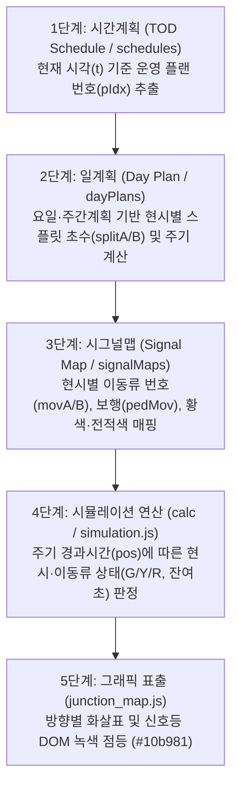

# SIGMA 엑셀 분석 및 시뮬레이터 로직 매뉴얼 (2026-04-23 업데이트)

이 문서는 교통 신호 대시보드(SIGMA)의 핵심 데이터 처리 및 시뮬레이션 엔진 로직을 설명합니다.

---

## 1. 엑셀 신호 데이터 정밀 분석 로직 (V4.0)

교차로 운영 엑셀 파일로부터 현시 계획 및 이동류 정보를 자동으로 추출하는 로직입니다.

### 1.1 기본 이동류(Movement) 정의
- **A링 이동류**: 엑셀 5행의 S열(19), X열(24), AC열(29), AH열(34), AM열(39), AR열(44), AW열(49), BB열(54)에서 1~8현시 이동류 번호를 순서대로 추출합니다.
- **B링 이동류**: 엑셀 12행의 동일한 열 구조에서 1~8현시 이동류 번호를 추출합니다.
- **매핑 방식**: 5행과 12행의 값은 해당 교차로의 **현시 순서(Phase Sequence)를 결정하는 절대적 기준**이 됩니다.

### 1.2 시그널맵 상세 분석 (247행 시작)
시그널맵은 각 현시에 할당된 LSU(Logical Signal Unit)의 구체적인 점등 상태와 보행 정보를 추출하는 데 사용됩니다.

- **현시 구분 (EOP)**: BE열(57번째 열)의 값이 **'Y'**인 행을 기준으로 현시를 구분합니다.
- **LSU 데이터 위치**: 
    - **차량 신호(V)**: E열(5번째 열)부터 6칸 간격 (5, 11, 17, 23, 29, 35, 41, 47)
    - **보행 신호(P)**: H열(8번째 열)부터 6칸 간격 (8, 14, 20, 26, 32, 38, 44, 50)
- **LSU 매칭**: 각 현시 구간에서 녹색(1) 또는 황색(2) 신호가 켜지는 LSU를 찾아내어, 해당 LSU의 보행 및 시간 정보를 5행/12행에서 정의한 이동류 번호와 연결합니다.
- **보행 ID 자동 부여**: 특정 LSU에 보행 신호(녹색 1, 점멸 5)가 존재함이 확인되면, 해당 현시의 **차량이동류번호 + 100**을 보행 ID로 자동 기록합니다.

---

## 2. 신호 시뮬레이션 엔진 로직 (연속 등화 업그레이드)

타임 슬라이더와 연동하여 실시간 신호 상태를 시각화하는 엔진의 로직입니다.

### 2.1 동일 이동류 신호 병합 (Merging)
- **전제 조건**: 현재 현시와 다음 현시의 차량이동류 번호가 동일할 경우 작동합니다.
- **로직**:
    - 두 현시 사이의 **황색(Yellow) 및 전적색(All-Red) 간격을 무시하고 초록불(Green)을 유지**합니다.
    - 신호는 해당 이동류 번호가 마지막으로 나타나는 현시가 끝날 때 비로소 황색으로 전환됩니다.
- **효과**: 연속된 직진 신호 등이 현시가 바뀔 때마다 끊기지 않고 부드럽게 유지되는 실제 현장 운영 상황을 완벽히 모사합니다.

### 2.2 스마트 잔여 시간 타이머
- **합산 연산**: 연속 등화가 적용되는 경우, 타이머는 현재 현시의 남은 시간뿐만 아니라 **다음에 올 동일 이동류 현시들의 시간을 모두 합산**하여 표시합니다.
- **정확도**: 1초 단위로 계산되어 사용자에게 정확한 신호 대기 및 유지 시간을 제공합니다.

---

## 3. 신호 시뮬레이터 기본 기능 및 데이터 연결 메커니즘 (Data Pipeline & Connectivity)

시뮬레이터는 **시간계획(TOD) → 일계획(Day Plan) → 시그널맵(Signal Map) → 등화 표출(Rendering)**의 4단계 데이터 파이프라인을 통해 방향별 화살표와 신호등에 실시간 녹색/황색/적색 신호를 표출합니다.

### 3.1 1단계: 시간계획 (TOD Schedule)
- **역할**: 현재 시뮬레이터 시각(`t`, 0~86399초)이 어느 운영 시간대(새벽, 출근, 낮, 퇴근, 심야 등)에 해당하는지 판단합니다.
- **연결 데이터**: `j.schedules[dayIdx]` (0~15개 시간표 슬롯: `{ h, m, cycle, offset }`)
- **결정 값**: 현재 시간대에 실행할 **시간계획 플랜 인덱스(`pIdx`)**.

### 3.2 2단계: 일계획 (Day Plan & Split)
- **역할**: 오늘 요일(평일/토/일/특수일)과 주간계획(`weeklyPlan`)에 따라 해당 플랜의 현시별 운영 초수를 가져옵니다.
- **연결 데이터**: `j.dayPlans[dayIdx][pIdx]` (`splitA`, `splitB`, `offset`, `yellowA`, `allredA` 등)
- **안전 우회(Fallback)**:
  - 주말 또는 특수일 계획(`dayIdx > 0`)이 비어 있거나(`splitA` 합계가 0), 엑셀에서 미작성된 경우 자동으로 최우선 기준인 **1번 일계획(`dayPlans[0]`)**으로 우회하여 신호가 꺼지지 않도록 방어합니다.

### 3.3 3단계: 시그널맵 (Signal Map) 매핑 및 무결성 검증
- **역할**: 각 현시가 진행될 때 실제로 점등해야 할 차량 이동류 ID(`movA`, `movB`), 보행 이동류 ID(`pedMovA`, `pedMovB`), 황색시간, 전적색시간을 결합합니다.
- **연결 데이터**: `j.dayPlanMapIds[dayIdx]` → `j.signalMaps[mapIdx]`
- **불완전 시그널맵 안전 폴백 규칙**:
  - 주말/특수일용 시차맵(1~4번)에 데이터가 없거나,
  - 이동류가 누락되었거나,
  - 황색시간/스텝이 전무하거나,
  - 운영 플랜은 다현시(2현시 이상)인데 시그널맵에는 1현시 이하만 정의된 불완전 맵(세종대로사거리 케이스 등)인 경우,
  - 시뮬레이터는 자동으로 표준 **1번 일반 시그널맵(`signalMaps[0]`)**으로 안전하게 우회하여 전체 현시가 정상 등화되도록 보장합니다.

### 3.4 4단계: 화살표/신호등 지도 객체 생성 (`junction_map.js`)
- **역할**: 교차로 주변에 차량 화살표(직진/좌회전 등) 및 보행자 신호등 마커를 Leaflet 레이어 상에 생성합니다.
- **보행자 신호 판별(`pedSet`)**:
  - 활성 시그널맵과 기본 일반 시그널맵의 모든 보행 이동류(`pMovA`, `pMovB`, 101~116번)를 `pedSet` Set 객체로 집합 관리합니다.
  - 이를 통해 차량 이동류(1~16번)와 보행자 신호(🚶)를 완벽히 구분하여 마커를 생성하고, `j.arrows[movId]`에 바인딩합니다.

### 3.5 5단계: 실시간 등화 연산 및 DOM 렌더링 (`simulation.js`)
- **주기 위치 계산**: `pos = ((t + offset + mainOS) % cycle + cycle) % cycle`
- **현시별 상태 판정 (`calc`)**:
  - `pos`가 현재 현시의 경과 시간 내에 위치할 때:
    - `All-Red 구간`: 적색(`R`) 또는 이전 현시와 동일 이동류인 경우 녹색(`G`) 유지
    - `녹색 구간`: 녹색(`G`) 및 남은 시간 카운트다운
    - `황색 구간`: 황색(`Y`) 또는 다음 현시와 동일 이동류인 경우 녹색(`G`) 유지
- **DOM 업데이트**:
  - 상태 객체 `activeStates[movId]`의 변화를 감지하여 해당 화살표 마커의 CSS 색상을 `#10b981`(녹색), `#f59e0b`(황색), `#ef4444`(적색)으로 즉시 갱신합니다.

---

## 4. 요약 (핵심 규칙)
1. **5/12행** = 현시별 이동류 번호 (고정)
2. **247행~** = LSU별 보행/황색 데이터 추출용
3. **E열/H열 (6칸 간격)** = 시그널맵 데이터 주소
4. **번호 동일 시** = 초록불 유지 및 시간 합산
5. **데이터 연결성** = 시간계획(pIdx) → 일계획(Splits) → 시그널맵(Mov/Yellow) → 등화 표출
6. **안전 폴백** = 불완전/미작성 시그널맵은 0번 일반 시그널맵으로 자동 우회하여 전 현시 무결성 유지

