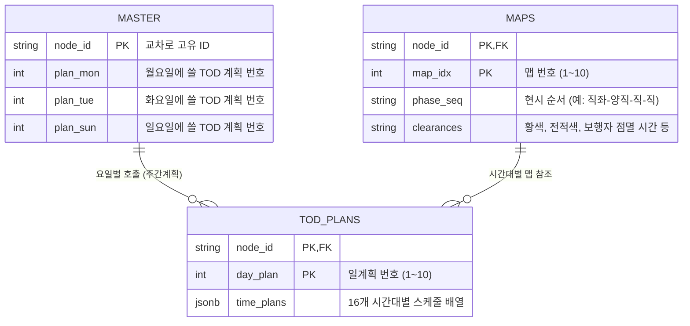
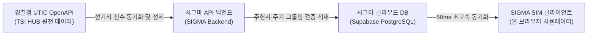

# SIGMA 데이터베이스 구조 및 관계 매뉴얼

SIGMA 시뮬레이션 엔진은 빠르고 효율적인 렌더링을 위해 데이터를 3개의 계층(파일)으로 분리하여 관리합니다. 처음 시스템을 접하는 사용자나 개발자라도 아래의 3계층 구조만 이해하면 전체 신호 연동 및 스케줄링 흐름을 쉽게 파악할 수 있습니다.

---

## 🏗️ 1. 전체 구조 개요 (The 3-Tier Architecture)

교통 신호 데이터는 크게 **①마스터(교차로 정보) - ②맵(통행권 구조) - ③TOD(시간 및 운영 스케줄)**로 나뉩니다.

---

## 🗂️ 2. 테이블별 핵심 역할과 데이터 포맷

### ① 교차로 마스터 (`junctions` 테이블 / `intersections` CSV)
* **역할**: 교차로의 이름, 위치(위경도), 그리고 **주간계획(Weekly Plan)**을 관리합니다.
* **주간계획이란?**: "이 교차로는 월요일엔 1번 스케줄을, 토요일엔 2번 스케줄을 켜라"라고 지시하는 요일별 캘린더입니다.
* **주요 항목**:
  - `ID`: 교차로 고유 번호 (예: L01-001)
  - `Lat` / `Lng`: 지도 위에 표시할 좌표
  - `Weekly_plan`: 요일별 운영계획 번호 배열 (월~일, 공휴일)

### ② 신호 맵 데이터 (`signal_maps` 테이블 / CSV)
* **역할**: 시간 개념이 전혀 없는, 순수한 **현시 순서(Phase Sequence)**와 **차량/보행자 통행권 구조**만을 정의합니다.
* **설명**: 1번 맵은 "출근시간용"이 아니라, "직좌-양직-직-직"이라는 **뼈대(템플릿)**입니다. 동일한 뼈대라면 아침이든 밤이든 이 맵 번호를 불러와 재사용합니다.
* **주요 항목**:
  - `MapIdx`: 맵 번호 (1~10번)
  - `movA`, `movB`: 각 현시(Phase)에서 차량이 이동할 수 있는 방향
  - `pedMovA`, `pedMovB`: 각 현시에서 켜지는 보행자 횡단보도
  - `yellowA`, `allredA`: 물리적 차로 길이에 따른 황색/전적색 (클리어런스) 고정 시간

### ③ TOD 운영계획 (`tod_plans` 테이블 / CSV)
* **역할**: **"시간(Schedule)"**과 **"신호 시간(Timings)"**을 한곳에 합쳐놓은 가장 중요한 테이블입니다. 하나의 Row 안에 하루 24시간 전체의 타임라인이 들어갑니다.
* **설명**: 교차로당 최대 10개의 일계획(Day Plan)을 만들 수 있으며, 각 일계획 안에는 최대 16개의 시간대(Time Slot) 블록이 들어있습니다.
* **주요 항목 (1개 시간대 블록 기준)**:
  - `시작 시간`: 예) 06:00
  - `맵 번호 (MapIdx)`: 이 시간에 가동할 신호 맵(뼈대) 번호
  - `주기 (Cycle)`: 1주기 전체 시간 (예: 140초)
  - `연동값 (Offset)`: 인접 교차로와의 녹색신호 연동(옵셋) 시간
  - `현시별 배분시간 (Splits)`: 1현시는 30초, 2현시는 40초 등 각 현시가 차지할 녹색 시간 (Split A/B)

---

## 🚀 3. 시뮬레이터(SIGMA_SIM) 작동 원리 및 데이터 연결 메커니즘

이 3계층 구조 덕분에 브라우저(프론트엔드)는 복잡한 데이터 조립 과정 없이, 아주 직관적으로 신호를 연산하고 렌더링합니다.

### 3.1 5단계 실시간 제어 파이프라인
1. **시간계획 조회 (TOD Schedules)**: 사용자가 설정한 현재 시각(0~86399초)을 바탕으로, 해당 요일에 할당된 TOD 스케줄 슬롯을 탐색하여 운영할 플랜 번호(`pIdx`)를 결정합니다.
2. **일계획 배분 (Day Plans & Splits)**: 해당 플랜의 현시별 스플릿 초수(`splitA`, `splitB`) 및 전체 주기(Cycle)를 추출합니다.
   * **[안전 우회]**: 주말/공휴일 플랜이 비어 있거나 스플릿 합이 0초인 경우, 자동으로 최우선 기본 플랜인 **1번 일계획(Day 1)**으로 우회합니다.
3. **시그널맵 결합 (Signal Maps)**: 각 현시가 점등될 때 실제로 켜질 방향별 이동류 ID(`movA`, `movB`), 보행 이동류 ID(`pedMov`), 황색(`yellow`), 전적색(`allred`) 시간을 결합합니다.
   * **[안전 폴백]**: 주말/특수일용 시차맵(1~4번)에 데이터가 없거나 1현시만 입력된 불완전 맵(세종대로사거리 케이스 등)인 경우, 자동으로 **0번 기본 일반 시그널맵**으로 우회하여 등화 누락을 차단합니다.
4. **실시간 등화 판정 (simulation.js / calc)**:
   * 주기 내 경과 시간(`pos = (t + offset) % Cycle`)을 계산하여 현재 현시를 결정합니다.
   * 현재 현시의 이동류에 녹색(`G`) 또는 황색(`Y`)을 부여하고 잔여 시간을 카운트다운합니다.
   * 이전/다음 현시와 이동류 번호가 같을 경우 황색/전적색 간격을 생략하고 녹색을 연속 유지(Signal Merging)합니다.
5. **화살표 및 신호등 DOM 표출 (junction_map.js)**:
   * 차량 이동류(1~16번)와 보행자 신호(`pedSet`)를 구분하여 지도 레이어 상에 마커를 생성합니다.
   * `activeStates` 연산 결과에 따라 해당 화살표/신호등 DOM 색상을 실시간으로 녹색(#10b981), 황색(#f59e0b), 적색(#ef4444)으로 즉시 전환합니다.

이러한 독립적 분리 구조는 중복 데이터를 줄여 파일 용량을 최소화하고, 서버 동기화(Bulk Upsert) 시 무결성 오류를 원천 차단합니다.

---

## 📋 4. UTIC 데이터 수집 및 TOD 일계획·시간계획 배치 표준 규격

도시교통정보센터(UTIC) 신호데이터 연동 시, SIGMA는 실시간 신호자동화와 수동 입력 충돌 방지를 위해 **NO 1~6 주기 그룹핑 및 24시간 시계열 스케줄링 표준**을 준수합니다.

### 4.1 하단 시간계획 (NO 1~6 및 INDEX 1~16 슬롯 배치 규칙)
* **슬롯 구성**: 총 6개의 NO 그룹과 총 16개의 INDEX 슬롯으로 분할 관리됩니다.
  - `NO 1` : 1개 슬롯 (`INDEX 1`) — 기본 기저 주기
  - `NO 2` : 3개 슬롯 (`INDEX 2, 3, 4`)
  - `NO 3` : 3개 슬롯 (`INDEX 5, 6, 7`)
  - `NO 4` : 3개 슬롯 (`INDEX 8, 9, 10`)
  - `NO 5` : 3개 슬롯 (`INDEX 11, 12, 13`)
  - `NO 6` : 3개 슬롯 (`INDEX 14, 15, 16`)
* **동일 주기 배치 원칙**: 하나의 NO 그룹에는 **반드시 동일한 주기(Cycle)만 배치**되며, 서로 다른 주기는 동일한 NO에 공존할 수 없습니다.
* **오름차순 정렬 및 빈칸 유지**: 주기가 낮고 시작시간이 빠른 순으로 NO 1부터 배치하며, 동일 주기가 3개가 되지 않더라도 빈칸으로 두고 **주기가 달라지면 다음 NO 그룹으로 이동**합니다.
* **실시간 신호 자동화 연계 목적**:
  - 도심 정체 시 신호주기를 단계별로 상향하고, 상향된 각 주기(NO) 내에 **유입(Inbound), 균형(Balance), 유출(Outbound)**의 3가지 연동 패턴을 체계적으로 배치하기 위한 교통공학 표준 구조입니다.
  - 사용자가 모든 데이터를 직접 수동 입력할 때의 충돌을 방지합니다.

### 4.2 상단 일계획 (TOD 계획정보 시계열 스케줄링)
* **24시간 시계열 정렬**: 상단 일계획 슬롯(#1~#16)은 하루 24시간 동안의 운영 흐름을 나타내며, **시작 시각(timeMinutes 오름차순)** 순서대로 #1부터 차례대로 빈틈없이 정렬됩니다.
* **INDEX 참조 연동 (IDX 필드)**: 상단 일계획의 `IDX` 값은 하단 시간계획에 배치된 해당 **INDEX 번호(1~16)를 참조**하여, 특정 시간대에 정확한 스플릿 및 주기 패턴을 호출하도록 연결됩니다.

---

## 🌐 5. UTIC 데이터 수집 및 갱신 아키텍처 (시그마 API 중심 고속 파이프라인)

SIGMA 플랫폼은 안정적인 시뮬레이션과 초고속 데이터 서빙을 위해 경찰청 UTIC OpenAPI 직접 호출 방식을 지양하고, **시그마 API(클라우드 DB) 중앙 허브**를 통해 데이터를 동기화합니다.

### 5.1 수집 및 조회 로직
* **SIGMA SIM은 경찰청 API를 직접 조회하지 않음**:
  - 시뮬레이터는 이미 검증·정제되어 Supabase 클라우드에 적재된 **시그마 API의 데이터**를 즉시 받아옵니다 (~50ms 응답).
  - 이를 통해 외부 OpenAPI 호출 시 발생하던 수초~수십 초의 대기 지연, 주현시 누락, 타임아웃 문제를 원천 해결합니다.

### 5.2 데이터 갱신 규칙
* **원천 데이터 최신화는 시그마 API에서 전담**:
  - 도시교통정보센터(UTIC) 신호데이터의 최신화(갱신)는 클라이언트 브라우저가 아니라, **시그마 API 백엔드(DB 센터 동기화 엔진)**에서 수행해야 합니다.
  - 시그마 API에서 갱신이 완료되면 Supabase RDB에 최신 버전이 기록되며, 시뮬레이터의 [동기화 실행] 또는 [UTIC 신호 가져오기]를 통해 즉시 화면에 반영됩니다.

